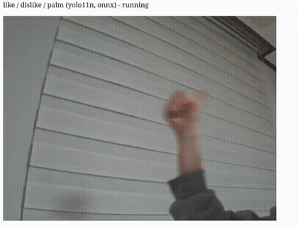
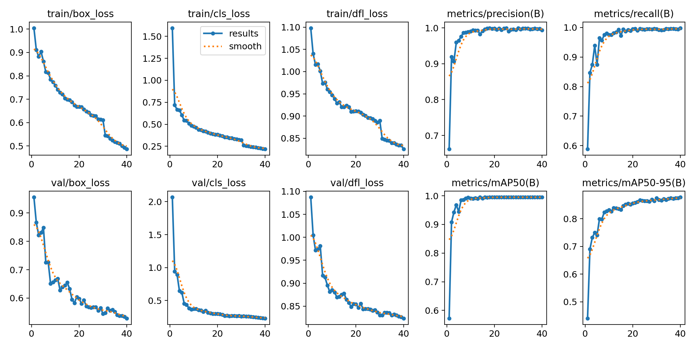
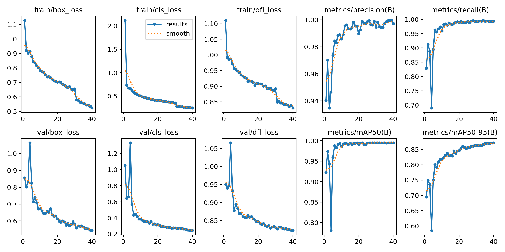
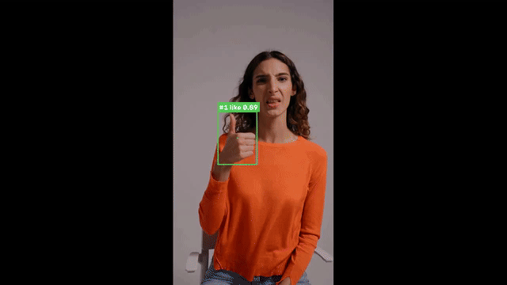
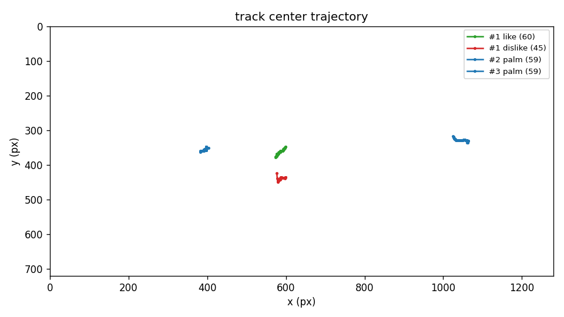

# YOLO 3-class gesture tracking

손동작 3개(like / dislike / palm)를 
YOLO11 로 fine-tuning 한 이후, 동영상에서 감지/추적 및 분석

| class          | 의미 (리모컨) |
| -------------- | -------- |
| `like`&nbsp;&nbsp;&nbsp;&nbsp;&nbsp;&nbsp;👍 | 볼륨 업     |
| `dislike`&nbsp;👎  | 볼륨 다운    |
| `palm`&nbsp;&nbsp;&nbsp;&nbsp;&nbsp;&nbsp;✋  | 일시정지     |

<br/>
COCO 사전학습 모델에는 손 / 제스처 클래스 존재하지 않음.

별도의 물리적 조작이나 사물 없이 카메라만 연동된 환경에서 손동작만으로 인식 가능:

게임 입력으로 활용하거나, 일상생활에서 음량 등을 원격 조절하는 등 다양하게 응용할 수 있음.




**웹캠 데모** : https://difficcd.github.io/YOLO-3class-tracking/
(yolo11n onnx + onnxruntime-web)
<br/><br/>
## Dataset

- [HaGRID](https://github.com/hukenovs/hagrid) 의 Kaggle 샘플 [hagrid-sample-30k-384p](https://www.kaggle.com/datasets/innominate817/hagrid-sample-30k-384p) 3개 클래스만 사용 (CC BY-SA 4.0)
- train / val / test 를 user_id 기준 분리

| split | images | like | dislike | palm |
|---|---|---|---|---|
| train | 4245 | 1406 | 1426 | 1413 |
| val | 520 | 167 | 187 | 166 |
| test | 520 | 159 | 170 | 191 |

(변환한 데이터셋: [Release dataset-v1](https://github.com/difficcd/YOLO-3class-tracking/releases/tag/dataset-v1) )
<br/><br/>
## Training

Colab T4, [train_colab.ipynb](train_colab.ipynb)

- COCO 사전학습 가중치에서 시작, Detect head 만 3클래스로 바뀌고 나머지 (backbone, neck) 가중치는 그대로 사용 (`Transferred 493/499 items`)
- epochs 40, imgsz 512, batch 32, optimizer auto (AdamW), patience 10
- yolo11n / yolo11s 두 개 학습시킨 이후 비교

| model   | params | train time | val mAP50-95 | **test mAP50** | **test mAP50-95** | T4 inference |
| ------- | ------ | ---------- | ------------ | -------------- | ----------------- | ------------ |
| yolo11n | 2.6M   | 25.8 min   | 0.872        | 0.995          | 0.869             | 3.1 ms       |
| yolo11s | 9.4M   | 28.0 min   | 0.878        | 0.995          | 0.881             | 5.1 ms       |

test set 클래스별 (yolo11s)

| class | P | R | AP50 |
|---|---|---|---|
| like | 0.993 | 0.981 | 0.995 |
| dislike | 1.000 | 0.989 | 0.995 |
| palm | 0.996 | 1.000 | 0.995 |

박스를 얼마나 딱 맞추는지 보는 mAP50-95 에서 s 가 1.2%p 높은 것을 확인했으며,
영상 추적은 yolo11s 로 진행

|                       | yolo11s                                                   | yolo11n                                                   |
| --------------------- | --------------------------------------------------------- | --------------------------------------------------------- |
| loss / metric         |                           |                           |
| test confusion matrix |  |  |


<br/><br/>
## Tracking

[track_video.py](track_video.py) - YOLO: `model.track(persist=True)` + ByteTrack

- 박스 위에 `#track_id class conf`
- 박스 중심점 궤적을 프레임마다 선으로 그림
- 궤적은 csv 로 따로 저장 → [plot_trajectory.py](plot_trajectory.py) 로 plot

결과 영상: [results/tracking_example.mp4](results/tracking_example.mp4) (5.5s)





입력 영상은 Pexels 무료 영상 3개(like / dislike / palm)를 이어 붙인 것
([8627746](https://www.pexels.com/video/8627746/), [9017833](https://www.pexels.com/video/9017833/), [8626650](https://www.pexels.com/video/8626650/))
<br/><br/>
## Run

```bash
pip install ultralytics

# dataset
python prepare_dataset.py --src hagrid-sample-30k-384p --dst datasets/gesture3

# train -> train_colab.ipynb (colab)

# tracking
python track_video.py --weights weights/yolo11s_best.pt --src input.mp4 --out results/tracking.mp4
python plot_trajectory.py results/tracking_trajectory.csv results/trajectory.png
```

## Structure

```
prepare_dataset.py     hagrid json -> yolo txt, user_id split
train_colab.ipynb      fine-tuning (colab)
track_video.py         detect + track + trajectory
plot_trajectory.py     trajectory plot
weights/               yolo11s_best.pt, yolo11n_best.pt
results/               tracking video, 학습 그래프, confusion matrix
docs/                  webcam demo (github pages)
```
