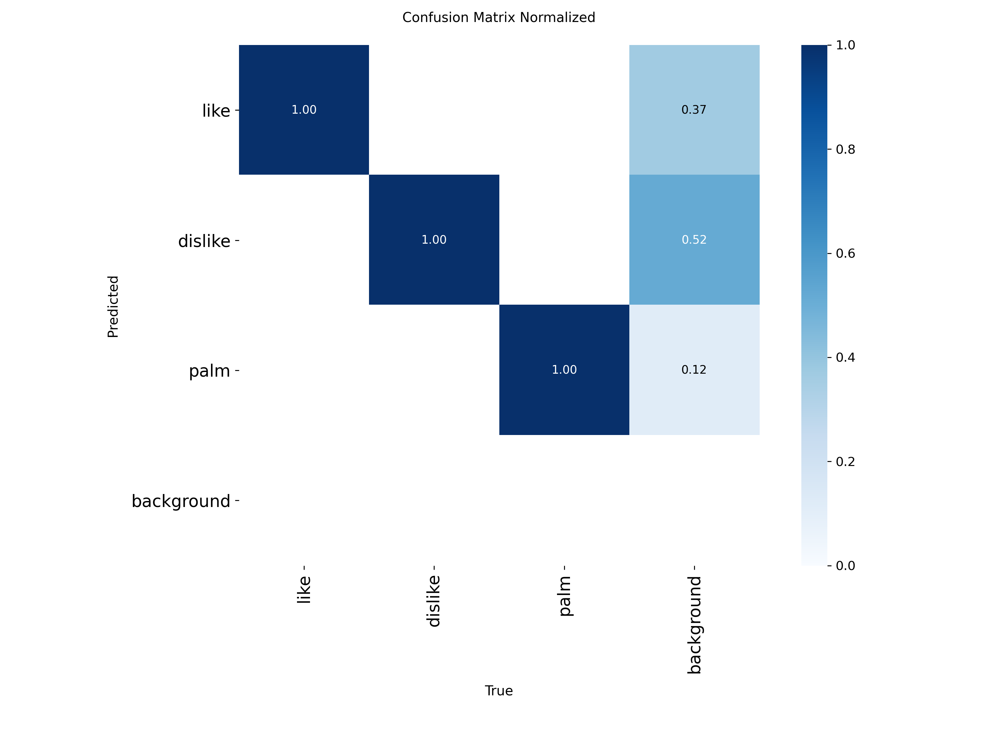

# YOLO 3-class gesture tracking

손동작 3개(like / dislike / palm)를 YOLO11 로 fine-tuning 하고, 동영상에서 감지 + 추적까지 해본 과제.

제스처 리모컨 같은 걸 생각하고 고른 클래스.

| class | 의미 (리모컨) |
|---|---|
| `like` 👍 | 볼륨 업 |
| `dislike` 👎 | 볼륨 다운 |
| `palm` ✋ | 일시정지 |

COCO 사전학습 모델에는 손 / 제스처 클래스가 없어서 (person 만 있음) 새로 학습해야 하는 부류.


**웹캠 데모** : https://difficcd.github.io/YOLO-3class-tracking/
(카메라 허용하면 브라우저에서 바로 돌아감, yolo11n onnx + onnxruntime-web. 영상은 서버로 안 나감)

## Dataset

- [HaGRID](https://github.com/hukenovs/hagrid) 의 Kaggle 샘플 [hagrid-sample-30k-384p](https://www.kaggle.com/datasets/innominate817/hagrid-sample-30k-384p) 에서 3개 클래스만 사용 (CC BY-SA 4.0)
- 한 이미지에 같이 찍힌 `no_gesture` 손 박스는 제외
- train / val / test 를 **user_id 기준**으로 분리 → 같은 사람이 train 과 test 에 동시에 안 들어가게

| split | images | like | dislike | palm |
|---|---|---|---|---|
| train | 4245 | 1406 | 1426 | 1413 |
| val | 520 | 167 | 187 | 166 |
| test | 520 | 159 | 170 | 191 |

변환한 데이터셋은 [Release dataset-v1](https://github.com/difficcd/YOLO-3class-tracking/releases/tag/dataset-v1) 에 올려둠.

## Training

Colab T4, [train_colab.ipynb](train_colab.ipynb)

- COCO 사전학습 가중치에서 시작 → Detect head 만 3클래스로 바뀌고 나머지 (backbone, neck) 가중치는 그대로 가져옴 (`Transferred 493/499 items`)
- epochs 40, imgsz 512, batch 32, optimizer auto (AdamW), patience 10
- yolo11n / yolo11s 두 개 돌려서 비교

| model | params | train time | val mAP50-95 | **test mAP50** | **test mAP50-95** | T4 inference |
|---|---|---|---|---|---|---|
| yolo11n | 2.6M | 25.8 min | 0.872 | 0.995 | 0.869 | 3.1 ms |
| yolo11s | 9.4M | 28.0 min | 0.878 | 0.995 | 0.881 | 5.1 ms |

test set 클래스별 (yolo11s)

| class | P | R | AP50 |
|---|---|---|---|
| like | 0.993 | 0.981 | 0.995 |
| dislike | 1.000 | 0.989 | 0.995 |
| palm | 0.996 | 1.000 | 0.995 |

mAP50 은 둘 다 거의 꽉 차서 차이가 없고, 박스를 얼마나 딱 맞추는지 보는 mAP50-95 에서 s 가 1.2%p 높음. 영상 추적은 yolo11s 로 진행.

| | yolo11s | yolo11n |
|---|---|---|
| loss / metric |  |  |
| test confusion matrix |  |  |

## Tracking

[track_video.py](track_video.py) - `model.track(persist=True)` + ByteTrack

- 박스 위에 `#track_id class conf`
- 박스 중심점 궤적을 프레임마다 선으로 그림
- 궤적은 csv 로 따로 저장 → [plot_trajectory.py](plot_trajectory.py) 로 plot

결과 영상: [results/tracking.mp4](results/tracking.mp4) (5.5s)


입력 영상은 Pexels 무료 영상 3개(like / dislike / palm)를 이어 붙인 것.
([8627746](https://www.pexels.com/video/8627746/), [9017833](https://www.pexels.com/video/9017833/), [8626650](https://www.pexels.com/video/8626650/))

## Run

```bash
pip install ultralytics

# dataset
python prepare_dataset.py --src hagrid-sample-30k-384p --dst datasets/gesture3

# train -> train_colab.ipynb (colab)

# tracking
python track_video.py --weights weights/yolo11s_best.pt --src input.mp4 --out results/tracking.mp4
python plot_trajectory.py results/tracking_trajectory.csv results/trajectory.png
```

## Structure

```
prepare_dataset.py     hagrid json -> yolo txt, user_id split
train_colab.ipynb      fine-tuning (colab)
track_video.py         detect + track + trajectory
plot_trajectory.py     trajectory plot
weights/               yolo11s_best.pt, yolo11n_best.pt
results/               tracking video, 학습 그래프, confusion matrix
docs/                  webcam demo (github pages)
```
